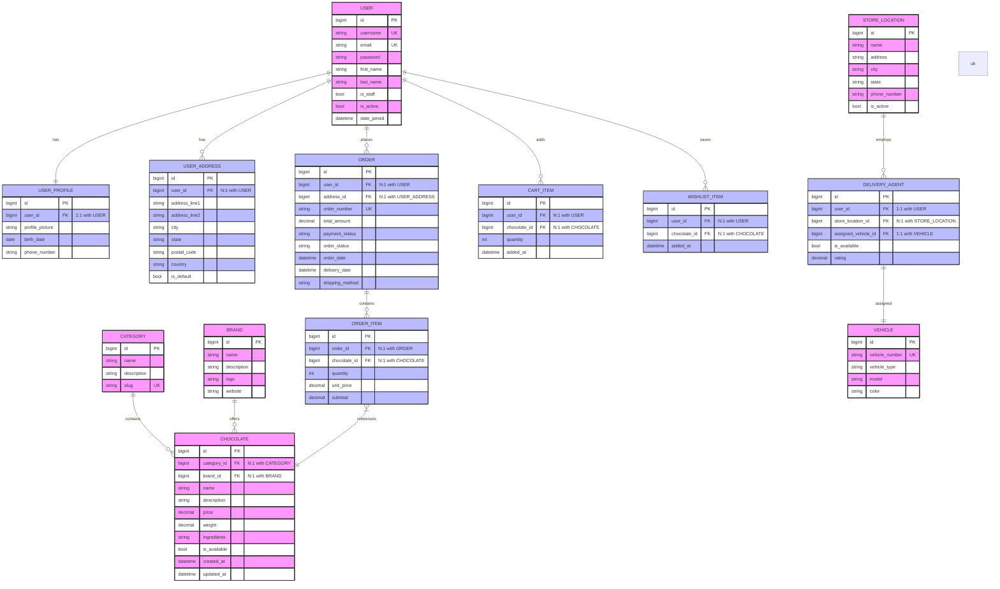

# GourmetGrove - Complete ER Diagram with Attributes and Relationships

## Legend
- **PK**: Primary Key (Pink background)
- **UK**: Unique Key (Green background)
- **FK**: Foreign Key (Blue background)
- **1:1**: One-to-One relationship
- **1:N**: One-to-Many relationship
- **N:1**: Many-to-One relationship
- **o{**: Zero or more
- **||**: Exactly one
- **}o{**: Many-to-Many (not directly used in this diagram)
