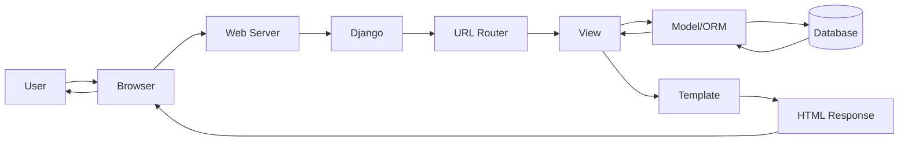
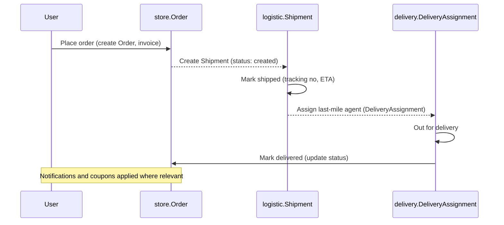
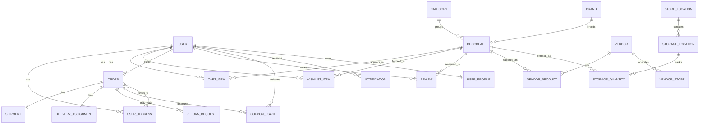

# Main Document: The Gourmet Groove (Chocolate E‑Commerce)

## 1. Project Overview
The Gourmet Groove is a monolithic Django web application for an online chocolate store. Users can discover chocolates by category and brand, view detailed product pages, add items to wishlist and cart, apply coupons (including special event offers like birthdays), place orders, write reviews, and manage addresses. Admins manage products, brands, vendors, store locations, stock bins, orders, shipments, delivery agents, and coupons. The UI uses Django Templates with a responsive theme and local media storage.

High-level capabilities:
- **Browse & search** chocolates by `Category` and `Brand` with images and tags.
- **Product details**: images, description, price, rating, reviews, and “new/trending” signals.
- **Wishlist & Cart**: quick toggles, quantity updates, cart share links.
- **Checkout & Orders**: address selection, invoice generation, delivery status.
- **Coupons & Offers**: generic and contextual rules (e.g., birthday, first purchase, time-based).
- **Reviews & Ratings**: one review per user/order; automatic average rating updates.
- **Delivery & Logistics**: shipments, 3P partners, last-mile delivery assignments.
- **Inventory & Locations**: physical store locations, storage bins, and per-bin quantities.

## 2. Core Technologies
- **Backend**: Django (Python)
- **Database**: SQLite (development)
- **Auth**: Django built-in authentication (Signup/Login/Logout)
- **Templates/Static**: Django Templates, app `static/` and global assets
- **Media**: Django `MEDIA_URL`/`MEDIA_ROOT` for images and downloads
- **i18n**: Locale directories present (`locale/`) for future translations

## 3. Features Implemented
- **Catalog & Products (`store/`)**
  - Models: `Category`, `Brand`, `Chocolate`
  - Fields: name, description, price, tags, image, brand, category, rating, sales, created_at
  - Behaviors: `Chocolate.update_rating()`, `is_trending()`, `is_new()`

- **Cart & Orders (`store/`)**
  - Models: `CartItem`, `Order`
  - Order: invoice number generation, delivery status, subtotal/total calculation
  - Addressing: `UserAddress` with default selection and enforcement
  - Cart sharing: `CartShare` with expiring tokens

- **Wishlist & Reviews (`store/`)**
  - Models: `WishlistItem` (unique per user/chocolate), `Review` (unique per user/chocolate/order)
  - Product rating auto-updates after reviews

- **Coupons & Offers (`store/`)**
  - Models: `Coupon`, `CouponUsage`, `BirthdayOffer`
  - Rules supported: percentage/fixed discount, min order, max discount, usage limit/time window
  - Example codes handled in logic: `SWEETBIRTHDAY`, `WELCOME10`, `FREESHIP`, `CHOCOLATEISLIFE`, `MIDNIGHTMUNCH`

- **Notifications & Returns (`store/`)**
  - Models: `ReturnRequest` (rich reason choices, statuses), `Notification` (read/unread, return-linked)

- **User Profiles & Addresses (`store/`)**
  - Models: `UserProfile` (picture, DOB, phone; birthday checks), `UserAddress` (default address enforcement)

- **Vendors (`vendor/`)**
  - Models: `Vendor`, `VendorStore`, `VendorProduct`, `Brand`
  - Map vendors to chocolates and optional brand; maintain vendor stores

- **Stock & Location (`stock_and_location/`)**
  - Models: `StoreLocation`, `StorageLocation`, `StorageQuantity`
  - Track quantities per-bin for each chocolate at a store

- **Logistics & Delivery (`logistic/`, `delivery/`)**
  - Logistics models: `DeliveryEstimate`, `LogisticsPartner`, `ShipmentStatus`, `Shipment` (mark shipped/delivered)
  - Delivery models: `Vehicle`, `DeliveryAgent`, `DeliveryAssignment` (mark delivered)
  - Integrations: `Shipment` and `DeliveryAssignment` both link to `store.Order`

- **Admin Panel (`admin/` registrations across apps)**
  - Admin interfaces to manage SKUs, orders, returns, shipments, agents, coupons, vendors

## 4. Next Feature Implementations
- **Smart Recommendations**
  - Personalized suggestions using views, cart, wishlist, and order history
  - Surfaces “Because you liked Dark Chocolate” and “Trending near you” sections

- **Social Logins**
  - Google/GitHub OAuth for faster signups and fewer password resets
  - Increases conversion and reduces sign-in friction

(Optional future items: payment gateway integration, order tracking page with live timeline, review moderation.)

## 5. Request Flow Diagram
A simplified path for a typical web request:

### App Responsibilities (Selected Models)
- **store/**
  - `Chocolate`: core product entity; images, brand, category, price, rating
  - `Order`: user, chocolate, quantity, address, invoice, delivery_status
  - `Review`: one per user/chocolate/order; drives `Chocolate.update_rating()`
  - `Coupon`/`CouponUsage`: validation rules and discount calculations
  - `WishlistItem`, `CartItem`, `CartShare`; `UserProfile`, `UserAddress`
  - `ReturnRequest` and `Notification` for post-order workflows

- **delivery/**
  - `Vehicle`, `DeliveryAgent`, `DeliveryAssignment`: last‑mile handoff for each `Order`

- **logistic/**
  - `Shipment`, `ShipmentStatus`, `LogisticsPartner`, `DeliveryEstimate`: shipment lifecycle and ETA

- **vendor/**
  - `Vendor`, `VendorStore`, `VendorProduct`, `Brand`: supplier and catalog mapping

- **stock_and_location/**
  - `StoreLocation`, `StorageLocation`, `StorageQuantity`: store/bin level inventory

## 5. Request Flow Diagram (Extended)
In addition to the generic request path, the sequence below shows how an order moves from checkout to last‑mile delivery.

### ER Diagram (Text-Based)

## 6. Conclusion
The Gourmet Groove delivers a complete chocolate e‑commerce experience on Django, covering catalog management, carts, orders, coupons, returns, vendors, inventory by location, logistics, and last‑mile delivery. The design leverages clear model relations (e.g., `store.Order` ↔ `logistic.Shipment` and `delivery.DeliveryAssignment`) and practical business rules (birthday/first‑order coupons, default addresses, review‑driven ratings). With the proposed roadmap for recommendations and social logins, the project is well‑positioned for higher engagement, faster onboarding, and scalable growth.
