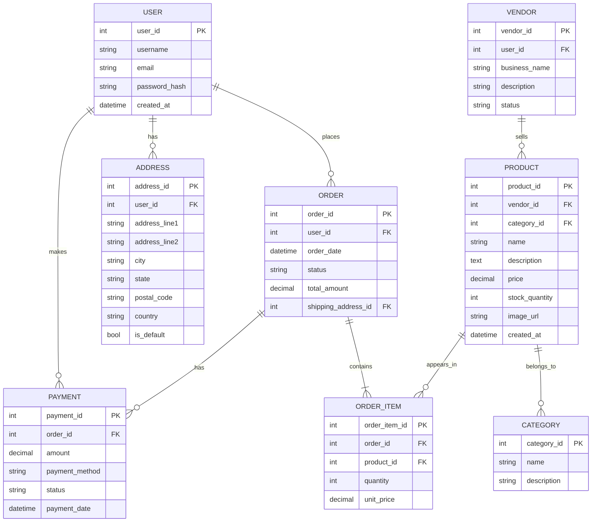

# The Gourmet Groove - Project Documentation

## 1. Introduction
GourmetGrove is a sophisticated Django-based e-commerce platform specializing in premium chocolates. This document provides a comprehensive overview of the project, its architecture, and implementation details. The platform serves as a digital marketplace connecting chocolate enthusiasts with premium chocolate vendors, offering a seamless shopping experience with features like real-time inventory tracking, secure payments, and order management.

## 2. Objective
The primary objectives of GourmetGrove are:
- To create a user-friendly platform for chocolate enthusiasts to discover and purchase premium chocolates
- To provide vendors with robust tools for managing their product listings and orders
- To implement a secure and scalable e-commerce solution
- To ensure a responsive and intuitive user experience across all devices
- To maintain efficient inventory and order management systems

## 3. Technology Stack
### Backend
- **Framework**: Django 5.2.4
- **Database**: SQLite (Development) / PostgreSQL (Production)
- **Server**: ASGI (Asynchronous Server Gateway Interface)
- **Authentication**: Django's built-in authentication system
- **API**: Django REST Framework (if applicable)

### Frontend
- **HTML5, CSS3, JavaScript**
- **Bootstrap 5** for responsive design
- **jQuery** for DOM manipulation and AJAX

### Payment Integration
- **PayPal** for secure payment processing
- Support for credit/debit cards and PayPal balance

### Development Tools
- **Version Control**: Git
- **Package Management**: pip
- **Virtual Environment**: venv

## 4. Features Implemented

### User-Facing Features
- User registration and authentication
- Product catalog with categories and search functionality
- Shopping cart and wishlist management
- Secure checkout process
- Order tracking
- User profile management
- Product reviews and ratings

### Vendor Features
- Vendor registration and dashboard
- Product management (add/edit/delete products)
- Inventory management
- Order management
- Sales analytics and reports

### Admin Features
- User and vendor management
- Content management
- Order monitoring and management
- System configuration
- Sales and performance analytics

## 5. Functional Overview

### User Flow
1. **Browsing**: Users can browse products by categories or use the search functionality
2. **Account Management**: Users can register, login, and manage their profiles
3. **Shopping**: Add products to cart, apply coupons, and proceed to checkout
4. **Checkout**: Secure payment processing and order confirmation
5. **Order Tracking**: View order status and history

### Vendor Flow
1. **Registration**: Vendors can register and get verified
2. **Product Management**: Add, edit, or remove products
3. **Order Management**: View and process customer orders
4. **Analytics**: Access sales reports and performance metrics

### Admin Flow
1. **Dashboard**: Overview of system performance
2. **User Management**: Manage user accounts and permissions
3. **Content Management**: Update website content and product categories
4. **System Monitoring**: Monitor orders, payments, and system health

## 6. ER Diagram

## 7. Conclusion
GourmetGrove successfully implements a comprehensive e-commerce solution for chocolate products, providing a seamless experience for both customers and vendors. The platform's robust architecture ensures scalability, security, and maintainability. Future enhancements could include:

- Integration with additional payment gateways
- Implementation of a recommendation engine
- Mobile application development
- Advanced analytics and reporting features
- Multi-language support

The project demonstrates strong adherence to Django best practices and follows a clean, modular architecture that allows for easy maintenance and future expansion.

---
*Documentation last updated: October 18, 2025*
