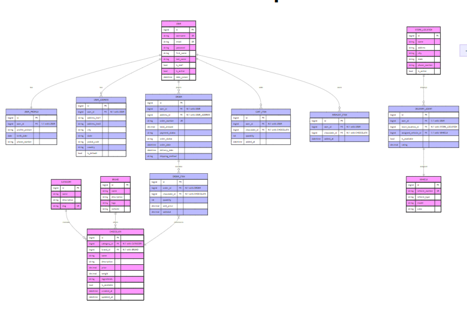

# The Gourmet Groove – Comprehensive Project Documentation (Long-form)

## Introduction
The Gourmet Groove is envisioned as a dedicated digital marketplace that celebrates the richness and diversity of premium chocolate. From its earliest conception, the platform has been designed to connect discerning chocolate enthusiasts with artisans and vendors who are passionate about quality, provenance, and craftsmanship. Rather than operating as a generic e‑commerce storefront, The Gourmet Groove focuses deeply on the nuances of chocolate—cocoa percentages, origin profiles, flavor notes, dietary considerations, and presentation—so that customers can make informed choices and enjoy an elevated shopping experience. 

At its core, the platform provides an intuitive and dependable end‑to‑end journey. A visitor can arrive without an account, explore thoughtfully curated product pages, and discover items through rich search and filtering capabilities that emphasize attributes relevant to chocolate. Once a user decides to purchase, the checkout flow is streamlined, secure, and respectful of user time: it reduces friction, preserves cart state, and presents clear summaries at each step. When an order is placed, customers can observe its progress through transparent order statuses and, where supported by logistics partners, follow shipping updates until delivery is complete. 

The project is equally considerate of the artisan or vendor who brings these chocolate creations to market. The vendor experience offers a structured path to onboarding, intuitive tooling for maintaining accurate product information and inventory, and an orderly framework for receiving and processing orders. For platform administrators, the system presents consistent oversight into content, users, and operational health, so that quality standards are met and the marketplace experience remains reliable. 

From a technical standpoint, the platform emphasizes clarity and maintainability. It follows established patterns in the Django ecosystem, adopts a clean separation of concerns between data, business logic, and presentation, and supports modern frontend practices for responsive interfaces. Although the development environment uses SQLite for speed and convenience, the design anticipates production deployment on a relational database such as PostgreSQL. The overall objective is to balance ambition and practicality: The Gourmet Groove should be delightful to use, trustworthy in its operations, and straightforward to evolve.

## Objective
The Gourmet Groove pursues a set of objectives that together define its purpose and guide its evolution. First, it aims to offer a refined, credible destination where customers can discover chocolates that match their tastes and preferences. That discovery process requires more than a list of products; it involves presenting rich product information, describing origins and ingredients with precision, and making comparisons effortless. Second, the project seeks to empower vendors by providing a space that reflects the care they put into their products. Vendors should be able to represent their catalog accurately, update stock levels as quickly as items move, and fulfill orders without confusion or delay. 

A third objective is to uphold security and privacy standards that users expect from any serious commerce platform. Payment flows must be handled through well‑established gateways that meet compliance requirements, personal data must be protected according to best practices, and access to sensitive information must be restricted according to clear roles and permissions. Fourth, the platform is intended to be scalable and maintainable so that it can grow alongside the community of customers and vendors. The architecture should accommodate increased traffic, larger catalogs, and more complex promotional and analytic features without costly rewrites. Finally, the user experience should be accessible and responsive across devices, ensuring that customers and vendors can engage with the platform comfortably from a phone, tablet, or desktop computer.

## Technology Stack
The Gourmet Groove is built upon a pragmatic and mature technology stack that aligns with the needs of a commerce platform while remaining approachable for contributors and maintainers. Django serves as the backbone of the application, providing a robust framework for defining models, managing migrations, establishing URL routing, and organizing views and templates. The project currently targets a modern release of Django, benefiting from incremental improvements in performance, security, and developer ergonomics. 

For data storage, the development environment uses SQLite because it is easy to set up, reliable for prototyping, and well supported by Django. This choice accelerates early iteration cycles and keeps the barrier to entry low for new contributors. At the same time, the application is designed to move to PostgreSQL for production deployments. PostgreSQL offers strengths that matter in a live commerce environment, including stronger concurrency handling, sophisticated indexing, and a broad ecosystem of extensions and operational tooling. This progressive strategy—SQLite for development and PostgreSQL for production—strikes a sensible balance between convenience and long‑term capability. 

The server layer adheres to the ASGI (Asynchronous Server Gateway Interface) standard, which allows the application to take advantage of asynchronous features in scenarios that benefit from concurrency, such as long‑running I/O or messaging. The authentication layer leverages Django’s built‑in authentication system to manage user accounts, sessions, and permissions reliably. Where an external API layer is required—for example, for integrating with modern frontend clients or facilitating vendor tooling—the application can expose endpoints using established Django libraries that emphasize clarity and maintainable serialization. 

On the client side, the platform uses HTML5, CSS, and JavaScript to present a responsive and accessible experience. The layout and components are composed with Bootstrap, which supplies a robust design system that scales across viewports while remaining customizable through theming and utility classes. Interactivity, such as form validation, dynamic updates, and AJAX requests, can be handled with light‑weight JavaScript patterns that prioritize performance and clarity. This approach keeps the frontend cohesive and approachable while still allowing room for progressive enhancement where needed. 

For payment processing, the platform integrates with PayPal, a widely trusted gateway that brings mature fraud detection, dispute resolution workflows, and regulatory compliance. By delegating the most sensitive aspects of payment handling to a reputable partner, the application lowers risk and reduces the need to build and maintain complex payment logic. The development environment is managed with virtual environments and pip to ensure dependency isolation. Source control is handled with Git, enabling versioned collaboration, code review, and continuous improvement.

## Features Implemented
The Gourmet Groove includes a set of features that are deliberately designed to address the needs of customers, vendors, and administrators without overwhelming any single user group. For customers, the journey begins with discovery. Visitors can navigate well‑organized categories and, when necessary, narrow results with search criteria that reflect how people evaluate chocolate: by cocoa content, origin, flavor inclusions, dietary suitability, and presentation. Product pages are written to be informative rather than merely descriptive. Each page aims to convey the qualities of a product—its texture, aroma, and tasting notes—alongside practical information such as ingredients, allergen warnings, weight, and packaging. Users can create accounts to preserve their preferences, manage saved addresses, and review past orders, but the browsing experience remains friendly to guests who are not yet ready to commit to an account. 

When a customer decides to purchase, the cart provides a clear overview that reflects item quantities, prices, and any applied promotions. The checkout process has been designed to minimize unnecessary steps and present decisions in a straightforward way. Address entry is streamlined, payment is processed securely through the integrated gateway, and order confirmation is issued promptly, with a summary that can be referenced later from the user’s account. After checkout, the customer can track the state of the order as it moves from confirmation to preparation, dispatch, and delivery. Where logistics integrations allow it, the user can see status updates that make the wait less opaque. 

For vendors, the platform focuses on clarity and control. The onboarding process ensures that a vendor’s profile reflects essential business details and that products are associated with the correct catalog structures from the beginning. Product management tools are designed to encourage accuracy by making it easy to update descriptions, upload images, adjust pricing, and reflect stock changes. When orders arrive, the vendor is presented with the information needed to fulfill them efficiently: itemized lists, customer details, and delivery instructions. If a vendor handles a large catalog or multiple variations, inventory controls help prevent disappointment by clearly signaling low stock levels or temporarily hiding items that cannot be fulfilled. 

Administrators are given a consolidated view of the marketplace to keep the experience consistent and trustworthy. They can review new vendors and ensure that listings meet stated quality guidelines. Administrative tools support interventions when necessary, such as assisting with order issues, verifying content accuracy, and managing high‑level configurations. The platform’s design encourages responsible access by granting permissions according to role and by logging sensitive operations for accountability. At every level of the feature set, the intent is to combine flexibility with restraint so that the system remains coherent and maintainable as it grows.

## Functional Overview
The functional behavior of The Gourmet Groove can be understood as a series of coordinated workflows that involve customers, vendors, and administrators. A typical customer journey begins on the home or catalog pages, where products are surfaced through curation and intelligent defaults. If the user searches, the platform returns results that take into account not only textual matches but also attributes that matter to chocolate buyers. The customer can click into a product page to learn more, view high‑resolution images, and confirm that the item fits their dietary preferences. Adding an item to the cart provides immediate feedback and does not interrupt browsing; the customer remains in control of when to proceed to checkout.

When the customer is ready, the checkout flow begins by confirming delivery information and summarizing costs. If the user is authenticated, saved addresses can be selected quickly; if not, the platform invites the user to create an account without forcing it as a precondition for purchase. The payment interface appears within a secure context provided by the payment gateway, reducing the surface area for sensitive data handling within the application itself. Once the transaction completes successfully, the platform records the order, adjusts inventory levels, and sends a confirmation that includes an order number and anticipated next steps. The customer can review this information later in an account area that also houses invoices and historical orders. 

For the vendor, daily work centers around maintaining an accurate catalog and fulfilling orders promptly. The vendor can add new products by entering detailed descriptions, uploading images, and selecting applicable categories. Inventory adjustments can be performed in response to new batches arriving or seasonal items rotating in and out of availability. When orders come in, the system presents a queue that emphasizes timeliness and completeness. Vendors can update order status to indicate preparation, dispatch, or exceptions that require attention. The vendor’s perspective also includes a view of sales trends over time, helping to identify best‑selling items, seasonal variations, and opportunities for targeted promotions.

Administrators operate at a supervisory level that crosses both catalog and operational concerns. They can review vendor applications, verify identities or certifications when required, and spot‑check product listings for accuracy and adherence to guidelines. The administrator’s view also includes system health: background tasks, error logs, and key performance metrics that indicate whether the platform is responding quickly and reliably. Administrative workflows may include the ability to override certain states for exceptional cases, such as assisting a customer with a change of address shortly after an order is placed or intervening in a vendor’s listing that requires immediate correction. Throughout these workflows, the platform maintains an audit trail where appropriate, ensuring that sensitive changes are visible to those with the right permissions.

## ER Diagram
The logical structure of data in The Gourmet Groove is organized around a few central entities that reflect the relationships among customers, vendors, products, and orders. Users represent the human actors who interact with the system, from casual shoppers to frequent buyers and vendor representatives. A user may have multiple saved addresses, which allows them to select among delivery locations during checkout. Vendors are modeled as distinct entities that link to users where appropriate; this separation allows the platform to capture business‑specific attributes such as company name, descriptions, and verification status without conflating them with the personal details associated with a user account.

Products are associated with vendors and grouped into categories so that the catalog can remain orderly as it grows. A product encapsulates descriptive text, pricing, images, and stock levels. Orders serve as the transactional heart of the platform, binding together a user, the items purchased, the amounts due, and the destination address. Each order is composed of one or more order items, each of which references a specific product and records the quantity and unit price at the moment of purchase. Payments are linked to orders and include information such as method, amount, status, and the time of capture. This structure supports partial payments or refunds if those scenarios are added in future iterations. 

The relationships among these entities can be summarized as follows: a user can place many orders, and each order can consist of multiple order items; each order item references exactly one product, and each product belongs to exactly one vendor and one category. Users can register multiple addresses, one of which may be designated as a default. Orders are associated with a single shipping address, chosen from the user’s saved addresses or entered at checkout. By capturing this information in a normalized, relational structure, the platform ensures data consistency, makes querying efficient, and lays a strong foundation for analytics. The diagram below provides a visual representation of these entities and their relationships. 

## Future Enhancements
As The Gourmet Groove continues to develop, the platform can embrace a series of carefully scoped improvements that reinforce its core principles of clarity, performance, and trust. A first area of investment is scalability. Beyond deploying a productiongrade relational database and an asynchronous server interface, the application can introduce judicious caching for catalog and product detail views, supported by a content delivery network that serves media assets geographically closer to customers. Read replicas and connection pooling would allow the database tier to absorb seasonal surges during promotions, while background workers process noninteractive tasks such as image optimization, invoice generation, and notification dispatch without impacting page responsiveness.

Product discovery can evolve from straightforward filtering into a richer, contextaware journey. A refined search pipeline may combine textual relevance with structured chocolate attributes, including origin, cocoa percentage, flavor inclusions, and dietary suitability, so that results feel immediately useful to enthusiasts. Personalization can be introduced with restraint and transparency, suggesting items on the basis of demonstrated preferences and seasonal trends. The interface should make it clear why a recommendation appears and provide simple controls to adjust or opt out of personalization, ensuring that customer agency is respected at every step.

The payments experience can broaden to reflect regional preferences and contemporary habits. Support for additional payment gateways and local methods, along with digital wallets where appropriate, would make the platform more welcoming across markets. Subscription offerings represent a natural extension of the catalog: customers could receive recurring assortments or singleorigin selections on predictable schedules. Implementing subscriptions requires careful attention to billing cycles, inventory reservations, proactive communication, and the ability to pause, skip, or modify deliveries without friction, all of which should be handled with the same clarity that governs onetime purchases.

Vendor enablement can deepen through actionable analytics and operational tooling. Visualizations that illuminate conversion funnels, repeatpurchase behavior, and the performance of particular flavor profiles allow artisans to refine their offerings with confidence. The vendor dashboard can introduce lightweight campaign management, promotional pricing windows, and limitedrelease drops while maintaining strong rolebased permissions and audit trails. For vendors with established backoffice systems, secure synchronization points for inventory, orders, and catalog data can reduce manual work and the risk of discrepancies, strengthening trust in the marketplaces data integrity.

Accessibility and internationalization merit ongoing, firstclass attention. A considered localization program that translates interface elements and supports localized product metadata will make discovery intuitive for more users across regions. Rigorous accessibility audits should validate semantic HTML, keyboard navigation, color contrast, and screenreader compatibility. Performance budgets can accompany these efforts so that translated and accessible interfaces remain fast on constrained networks and older devices, preserving the sense of responsiveness that underpins a pleasant shopping experience.

Reliability can be further strengthened through observability and automation. Centralized, structured logging paired with application metrics and alerts provides timely visibility into regressions and operational issues. A comprehensive automated test suite—spanning unit, integration, and endtoend flows—can run in continuous integration alongside static analysis, dependency vulnerability scans, and preview environments for review. Welldocumented backup and disaster recovery runbooks, exercised periodically, will ensure that the platform can recover gracefully from unlikely incidents without data loss or prolonged downtime.

Logistics and fulfillment present additional opportunities for refinement. If the marketplace supports multiple fulfillment locations, an allocator can select the optimal origin for each order on the basis of inventory and proximity to the customer, thereby reducing shipping times and costs. Deeper integrations with carriers may yield more precise estimated delivery windows and realtime status updates. Because chocolate is temperaturesensitive, packaging guidance and seasonal cutoff rules can be encoded directly into the order workflow so that shipments remain protected in warm months, with clear communication setting expectations before purchase.

From a data perspective, a privacypreserving analytics pipeline can inform curation, inventory planning, and merchandising without compromising user trust. An anonymized data warehouse that aggregates catalog, order, and interaction data allows exploratory analysis and controlled machine learning experiments, such as demand forecasting or churn detection. Any predictive features should include measurable success criteria, human oversight, and conservative fallback behavior to rulebased logic when models underperform or drift, ensuring that datadriven enhancements never diminish clarity or fairness.

Finally, the user experience can extend thoughtfully to additional surfaces. A progressive web application can provide offlinetolerant browsing and cart persistence on unreliable connections, while native applications may become compelling if devicespecific capabilities—such as camerabased barcode scanning, enriched notifications, or localfirst experiences—deliver tangible value. Editorial content, including tasting notes, maker stories, and pairing guides, can enhance engagement when it is integrated into the shopping journey rather than existing as a separate silo. By treating each enhancement as an incremental, testable addition, The Gourmet Groove can expand in capability while remaining coherent, performant, and a pleasure to use.

## Conclusion
The Gourmet Groove brings together a thoughtfully designed user experience and a pragmatic technical foundation to serve a specialized market with integrity and care. By focusing on the distinctive attributes of chocolate and the needs of the people who make and enjoy it, the platform goes beyond transactional utility to create an environment that is informative, credible, and enjoyable. The project’s architecture reflects the responsibilities inherent in commerce software: it respects privacy, delegates payment security to trusted providers, and manages data in a way that is both consistent and scalable. The operational tooling offered to vendors and administrators underscores a commitment to long‑term sustainability, ensuring that as the catalog grows and the audience expands, the system remains coherent and responsive. 

Looking forward, the platform has ample room to evolve without abandoning its foundational choices. It can support additional payment gateways to accommodate regional preferences, incorporate recommendation features that help customers discover new favorites, and expose APIs for deeper integrations with logistics or marketing systems. Accessibility and internationalization can be strengthened so that the experience feels native to users across languages and abilities. Mobile experiences—whether progressive web applications or native clients—can bring the marketplace closer to users in their daily contexts. Each of these enhancements would build upon the same principles that guide the current implementation: clarity, maintainability, and a focus on a delightful, trustworthy experience. 

In sum, The Gourmet Groove demonstrates how a focused domain and a disciplined approach to engineering can produce a marketplace that is both specialized and scalable. It meets immediate needs with care and leaves open clear avenues for future growth, ensuring that the platform remains relevant and rewarding for customers, vendors, and administrators alike. 

---
Documentation last updated: October 18, 2025

